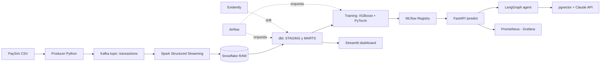

# Fraud Detection Platform

Proyecto end-to-end para portafolio que cubre tres perfiles en un solo sistema:
**Data Engineering**, **ML Engineering** y **AI Engineering**.

El sistema recibe transacciones financieras en tiempo (simulado) real, las guarda y transforma,
entrena modelos que detectan fraude, y usa un agente LLM para explicar en lenguaje simple
por qué una transacción fue marcada como sospechosa.

> Nivel: **junior**. El objetivo no es la complejidad del código sino que cada paso
> se entienda y se pueda explicar en una entrevista.

---

## 1. Arquitectura



Decisión de diseño importante: **el modelo decide si hay fraude; el LLM solo explica.**
El LLM nunca toma la decisión.

**Orden de construcción:** primero se valida el modelo con datos locales (Etapa A) y solo si resulta útil se construye el ecosistema alrededor (Etapas B a E). No se monta infraestructura para un modelo que todavía no sabemos si sirve.

---

## 2. Stack elegido

Criterio de selección: **herramienta potente + solicitada en ofertas de trabajo**
(no la más fácil). Cada herramienta tiene su propio documento con la justificación,
las alternativas descartadas, los parámetros clave y los enlaces a la documentación.

| Etapa | Elegida | Alternativas descartadas | Documento |
|---|---|---|---|
| Datos | PaySim | Kaggle Credit Card, IEEE-CIS | [00](docs/tools/00_paysim_dataset.md) |
| Ingesta / streaming | Apache Kafka | Redpanda, RabbitMQ, Kinesis | [01](docs/tools/01_kafka.md) |
| Procesamiento | Spark Structured Streaming | Flink, consumidor Python | [02](docs/tools/02_spark_structured_streaming.md) |
| Almacenamiento | Snowflake | Delta Lake, BigQuery, Redshift, DuckDB | [03](docs/tools/03_snowflake.md) |
| Transformación | dbt Core | SQL puro, Great Expectations, SQLMesh | [04](docs/tools/04_dbt.md) |
| Orquestación | Apache Airflow | Prefect, Dagster, cron | [05](docs/tools/05_airflow.md) |
| Nube | AWS | Azure, GCP | [06](docs/tools/06_aws.md) |
| Infra como código | Terraform | CloudFormation, Pulumi, CDK | [07](docs/tools/07_terraform.md) |
| Contenedores | Docker + Kubernetes | Compose solo, ECS, Nomad | [08](docs/tools/08_docker_kubernetes.md) |
| CI/CD | GitHub Actions | Jenkins, GitLab CI | [09](docs/tools/09_github_actions.md) |
| Modelos | XGBoost + PyTorch | LightGBM, CatBoost, Isolation Forest | [10](docs/tools/10_xgboost_pytorch.md) |
| Experimentos | MLflow | Weights & Biases, DVC | [11](docs/tools/11_mlflow.md) |
| Drift | Evidently | NannyML, Alibi Detect | [12](docs/tools/12_evidently.md) |
| Agente | LangGraph | LlamaIndex, llamadas directas | [13](docs/tools/13_langgraph.md) |
| Base vectorial | pgvector | Pinecone, Chroma, FAISS | [14](docs/tools/14_pgvector.md) |
| LLM | Claude API | OpenAI, Gemini, Ollama | [15](docs/tools/15_claude_api.md) |
| API | FastAPI | Flask, Django REST | [16](docs/tools/16_fastapi.md) |
| Observabilidad | Prometheus + Grafana | ELK, Datadog | [17](docs/tools/17_prometheus_grafana.md) |
| Dashboard | Streamlit | Gradio, Dash, Power BI | [18](docs/tools/18_streamlit.md) |

### Demanda en el mercado (referencia, 2026)

Porcentaje de ofertas de empleo que mencionan cada herramienta. Las cifras cambian según
cada análisis porque miden distinto; lo útil es el orden de magnitud.

| Herramienta | Análisis de 36,543 ofertas de Data Engineering (datadriven.io) | Análisis de 500+ ofertas, Q1 2026 (jobstrack.io) |
|---|---|---|
| AWS | 47.8% | - |
| Kubernetes | 32.6% | Docker o Kubernetes 28% |
| Terraform | 18.1% | - |
| Kafka | 12.8% | 31% |
| Spark | 12.4% | 43% |
| Snowflake | 9.9% | Snowflake o BigQuery 54% |
| Airflow | 7.5% | Airflow o Prefect 58% |
| dbt | 5.2% | 61% |

Para ofertas de AI Engineer (análisis de 3,449 ofertas, DEV Community): LangChain 25% y
PyTorch 23%. MLflow aparece en casi 30% de las ofertas de MLOps (Axial Search).

---

## 3. Estructura de carpetas

```
fraud-detection-platform/
├── README.md
├── requirements.txt          # Etapa A activa; Etapas B-E comentadas
├── requirements-lock.txt     # versiones exactas (se genera en el paso A2)
├── .env.example              # plantilla de variables secretas (sin valores reales)
├── .gitignore
├── docs/
│   ├── etapa_A_validar_modelo.md   # guía paso a paso de la Etapa A
│   └── tools/                      # un README por herramienta
├── data/                     # NO se sube a Git
│   ├── raw/                  # CSV original de PaySim
│   ├── interim/              # datos renombrados a español
│   └── processed/            # features y particiones train/valid/test
├── models/                   # modelos y umbrales guardados (NO se sube a Git)
├── notebooks/                # exploración (EDA)
├── reports/                  # decisión de la Etapa A, tablas y figuras
│   └── figures/
├── src/
│   ├── ml/                   # Etapa A: carga, features, métricas, entrenamiento
│   ├── ingestion/            # Etapa B: producer de Kafka
│   ├── streaming/            # Etapa B: job de Spark -> Snowflake
│   ├── agent/                # Etapa C: LangGraph + pgvector + Claude
│   ├── api/                  # Etapa C: FastAPI
│   └── dashboard/            # Etapa D: Streamlit
├── dbt_project/              # Etapa B: modelos SQL y tests de dbt
├── airflow/dags/             # Etapa C: DAGs de Airflow
├── monitoring/               # Etapa D: Prometheus, Grafana, Evidently
├── infra/
│   ├── terraform/            # Etapa E: AWS como código
│   └── kubernetes/           # Etapa E: manifiestos de K8s
├── docker/                   # Dockerfiles y docker-compose
├── tests/                    # pruebas con pytest
└── .github/workflows/        # Etapa E: CI con GitHub Actions
```

---

## 4. Etapas de implementación

El orden sigue lo que se hace en un proyecto real: **primero se comprueba que el modelo sirve y
después se construye todo lo demás.** Cada etapa termina con algo que se puede verificar.

| Etapa | Nombre | Herramientas | Terminamos cuando... |
|---|---|---|---|
| A | Validar el modelo (local) | pandas, scikit-learn, XGBoost, PyTorch, MLflow local | Hay una decisión escrita de seguir o no, basada en un criterio fijado antes de entrenar |
| B | ETL real | Kafka, Spark, Snowflake, dbt, Docker Compose | Las features de dbt coinciden con las de pandas y el modelo se reentrena con datos de Snowflake |
| C | Modelo en producción | Airflow, FastAPI, pgvector, LangGraph, Claude API | `/predict` y `/explain` responden y un DAG puntúa transacciones nuevas |
| D | Monitoreo y presentación | Evidently, Prometheus, Grafana, Streamlit | Hay dashboard de métricas, reporte de drift y panel de alertas |
| E | Entrega | Docker, Kubernetes, Terraform, GitHub Actions, AWS | CI en verde y todo levanta con comandos documentados |

**Puerta de decisión:** la Etapa B solo empieza si la Etapa A termina en "seguir".
Si el modelo no cumple el criterio, se vuelve a features y modelos con la partición de validación.

Guía detallada de la Etapa A: [docs/etapa_A_validar_modelo.md](docs/etapa_A_validar_modelo.md).
Las guías de las Etapas B a E se escriben cuando llegue su turno.

Cómo se hace el scoring en producción: Spark guarda cada transacción en Snowflake; un DAG de Airflow
puntúa las transacciones nuevas en lotes pequeños y escribe las alertas en una tabla.
El agente explica una alerta cuando se le pide.

---

## 5. Reglas de código (obligatorias)

1. **Código legible y básico.** Una acción por línea. Nada de encadenar muchas operaciones
   en una sola línea.
2. **Sin refactorización excesiva.** Funciones cortas (idealmente menos de 20 líneas),
   con una sola tarea. Se permite repetir un poco de código si así se entiende mejor.
3. **Nombres en inglés:** variables, funciones, clases y archivos (`transaction_amount`,
   `build_features.py`).
4. **Excepción: los datos van en español.** Los nombres de las columnas del dataset y los valores
   de `tipo` están en español, sin tildes ni ñ (`monto`, `es_fraude`, `retiro`). Se renombran una sola vez,
   con un diccionario en `src/ml/config.py`. Ejemplo: `transactions["monto"]`.
5. **Nombres descriptivos.** `transaction_amount`, no `amt`; `fraud_probability`, no `p`.
6. **Cada parámetro elegido se justifica** con este formato:

```python
# PARAMETER: acks = "all"
# WHY: wait until every replica confirms the message, so nothing is lost.
# OTHER OPTIONS: "0" (fastest, may lose data), "1" (only the leader confirms).
acks = "all"
```

7. **Cada archivo empieza con un docstring** que explica qué hace y en qué etapa se usa.
8. **Los secretos nunca van en el código.** Se leen desde `.env` (ver `.env.example`).
9. **Sin valores "mágicos" repartidos.** Rutas, semillas y listas de columnas viven en `src/ml/config.py`.
10. Los comentarios y documentos están en español; los identificadores, en inglés.

---

## 6. Requisitos previos y costos

**Para la Etapa A (lo único que se necesita al inicio):**
- Python 3.11, Git, un editor (VS Code recomendado).
- 8 GB de RAM como mínimo (16 GB recomendado) y 5 GB de disco libre.
- Cuenta gratuita de Kaggle para descargar el dataset.

**Para las Etapas B a E (se crean cuando llegue su turno):**
- Docker Desktop, Java 17 (Spark), cuenta de Snowflake, cuenta de AWS, API key de Anthropic.
- Para correr Kafka, Spark, Airflow, Postgres y Grafana a la vez conviene tener 16 GB de RAM.

Las cuentas de Snowflake y AWS se crean **después** de la decisión de la Etapa A, para no gastar
la prueba gratuita de Snowflake antes de tiempo.

Protecciones de costo (se configuran al crear cada cuenta, en la Etapa B):
- Snowflake: warehouse `XSMALL`, `AUTO_SUSPEND = 60` y un resource monitor con tope de créditos.
- AWS: alerta de presupuesto (AWS Budgets) antes de crear cualquier recurso.
- Claude API: se paga por uso; el agente llama al modelo solo cuando se le pide una explicación.

---

## 7. Cómo vamos a trabajar

Para cada etapa: (1) leemos su guía, (2) escribimos el código paso a paso, (3) lo ejecutamos y
verificamos con la comprobación indicada en la guía, (4) hacemos commit.

---

## 8. Limitaciones conocidas

- PaySim es un dataset **sintético**; los resultados no se pueden extrapolar a fraude real.
- La prueba gratuita de Snowflake termina. Para el portafolio público se dejará un video o GIF
  del flujo completo en el README, porque Kafka y Airflow no corren en hosting gratuito.
- Las versiones exactas de las librerías se fijan en el paso A2 con `pip freeze`.
